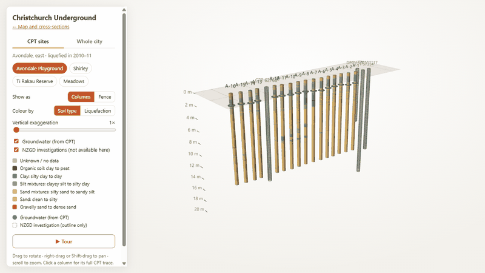

# Christchurch Underground

The ground beneath part of Christchurch in 3D, built from real borehole and CPT data.

> Status: Phase 0 (data spike). See [plan.md](plan.md) and [docs/phase-0.md](docs/phase-0.md).
>
> **Live page:** https://jchalmers811.github.io/christchurch-underground/. It maps four lines of OSU cone penetration tests and about 6,000 ECan wells, and draws the ground beneath each CPT line.
>
> **3D viewer:** https://jchalmers811.github.io/christchurch-underground/3d/ (CPT sites as columns or a fence diagram, coloured by soil type or by predicted liquefaction, click-through CPT traces, and a whole-city view of about 5,000 wells)



## Repo layout

| Folder | What |
|---|---|
| `pipeline/` | Python: ingest, validate and reproject source data |
| `site/` | The published page, generated by `python -m chch_pipeline.page` (needs `data/raw/`) |
| `docs/` | Phase plans, the [decisions log](docs/decisions.md) and a [glossary](docs/glossary.md) |
| `data/` | Local data, **git-ignored**. Raw NZGD files must never be committed (see D-001). |

| `web/` | The 3D viewer: Vite + TypeScript + deck.gl (see D-004) |

`api/` arrives later in Phase 1.

## Running the pipeline tests

Needs Python 3.11+.

```bash
python -m venv .venv
# Windows: .venv\Scripts\activate    macOS/Linux: source .venv/bin/activate
pip install -e "pipeline[dev]"        # add ,media for the basemap/GIF tools
cd pipeline
ruff check .
pytest
```

## Rebuilding the published data

The raw data never leaves your machine, so the derived files are generated locally and committed:

```bash
cd pipeline
python -m chch_pipeline.page         # site/index.html (map + cross-sections)
python -m chch_pipeline.export_web   # web/public/data/*.json (3D viewer data)
python -m chch_pipeline.basemap      # web/public/data/city-basemap.* (needs the media extra; fetches OSM tiles once)
```

## Running the 3D viewer

Needs Node 22+.

```bash
cd web
npm install
npm run dev      # local dev server
npm run build    # typecheck + production build into web/dist
```

## What this can't tell you (so far)

- **Soil type is inferred, not sampled.** Colours come from how the soil resists the cone (Robertson soil behaviour type), not from lab tests.
- **Liquefaction is a screening calculation**, not a design check (D-005). It over-predicts at Meadows, the site that *didn't* liquefy: it ignores the clay layer capping the loose sands there.
- **Ground levels are relative** within each CPT line until the LINZ DEM is added.
- **The fence diagram doesn't interpolate.** Each CPT owns the stretch of line halfway to its neighbours.
- **ECan well depths aren't soil logs.** Most wells' layer descriptions exist only as images on ECan Well Search.

## Data and attribution

- CPTs: Stuedlein, A., A. Jana, J. Cary (2021). "Subsurface Investigation at Selected Liquefaction Case History Sites, Christchurch, NZ", in Role of Spatial Variability in Liquefaction Consequence Severity. DesignSafe-CI. https://doi.org/10.17603/ds2-fy1v-hh47. Licensed under ODC-BY.
- Wells: Environment Canterbury (Canterbury Regional Council), "Wells & Bores – Existing", via data.govt.nz, licensed under CC BY 4.0. Owner names and addresses are not published.
- Map image in the 3D city view: © OpenStreetMap contributors.
- Elevation: sourced from the LINZ Data Service and licensed by Toitū Te Whenua Land Information New Zealand for re-use under CC BY 4.0.
- Includes data derived from the New Zealand Geotechnical Database (MBIE), accessed free of charge and provided without warranty as to accuracy or fitness for purpose.
